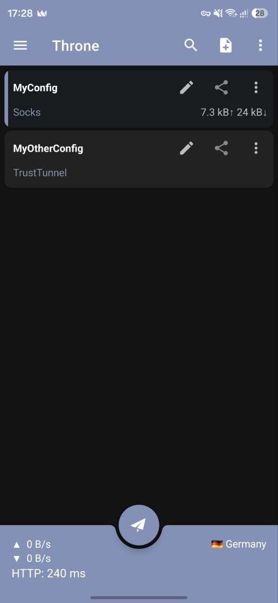

# Throne for Android

**Android proxy client, powered by [sing-box](https://github.com/SagerNet/sing-box)**

Throne for Android manages proxy profiles and subscriptions, routes traffic with rule-based routing profiles, and works either as a VPN or as a proxy-only service. It shares [Throne](https://github.com/throneproj/Throne) desktop's core and data model, so profiles, share links, route profiles and `.thrbackup` backups move freely between the two. See the [documentation](https://throneproj.github.io) for guides.

  

## Installation

APKs for arm64-v8a, armeabi-v7a and x86_64 are on [GitHub Releases](https://github.com/throneproj/ThroneForAndroid/releases), with a `SHA256SUMS` file to verify them. Throne runs on Android 7.0 (API 24) or newer, including Android TV.

### Upgrading from 1.x
Releases from v2.0.0 on are signed with a new key, so Android refuses to install them over a 1.x release (signature conflict). Uninstall the old release first, then import your subscriptions and profiles again: old local configurations are not migrated.

## Supported protocols

- SOCKS
- HTTP(S)
- Shadowsocks
- Trojan
- VMess
- VLESS
- TUIC
- Hysteria
- Hysteria2
- AnyTLS
- Mieru
- Snell
- NaïveProxy
- Juicity
- TrustTunnel
- ShadowTLS
- Wireguard
- AmneziaWG
- MASQUE
- SSH
- DNSTT / VayDNS
- MasterDNS
- Xray VLESS (XHTTP/XDrive)
- OpenVPN/OpenConnect
- Custom Outbound (Both Sing-box and Xray)
- Custom Config (Both Sing-box and Xray)
- Chaining outbounds

## Subscription Formats

Various formats are supported, including share links, various JSON representation of Sing-box configs, and v2rayN link format as well as limited support for Shadowsocks and Clash formats.

Deeplinks are also supported, read the [documentation](https://throneproj.github.io/advanced/deeplinks/) for more information.

## Credits

- [SagerNet/sing-box](https://github.com/SagerNet/sing-box)
- [XTLS/Xray-core](https://github.com/xtls/xray-core)
- [SagerNet/sing-box-dashboard](https://github.com/SagerNet/sing-box-dashboard)
- [MatsuriDayo/NekoBoxForAndroid](https://github.com/MatsuriDayo/NekoBoxForAndroid)
- [SagerNet/SagerNet](https://github.com/SagerNet/SagerNet)
- [shadowsocks/shadowsocks-android](https://github.com/shadowsocks/shadowsocks-android)

## Supporting Throne

If Throne is useful to you, you can support its development through [GitHub Sponsors](https://github.com/sponsors/Mahdi-zarei) or with a crypto donation to one of these addresses:

| Coin | Network | Address |
|:--|:--|:--|
| **USDT** · **TRX** | TRON (TRC20) | `THR2gbWMaTZh8ACk3VYAAyNRVffvdTRikj` |
| **USDT** · **USDC** | BNB Smart Chain (BEP20) · Ethereum (ERC20) | `0x7c2dF1867f5AaEE807a835fB3c55E4de4507888A` |
| **XMR** | Monero | `4AYwwN8qMQCSUb3XfwzfrLNPMHfDme6U7CmNtQY4idCF8GtHHLG68VA3iZK867ypuKFr8J7CjXiJ96eFUA2T6aLVRUbgY3A` |
